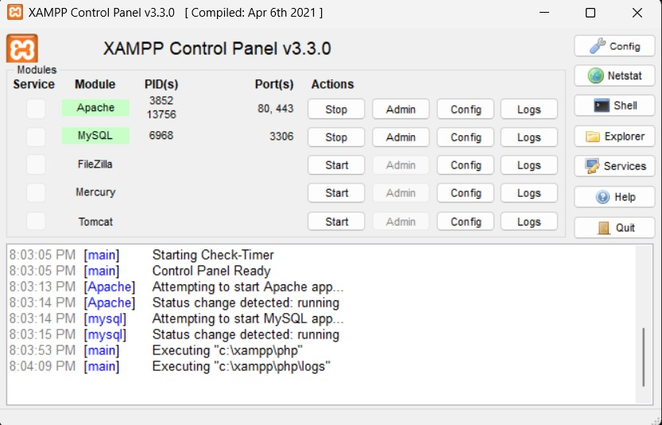
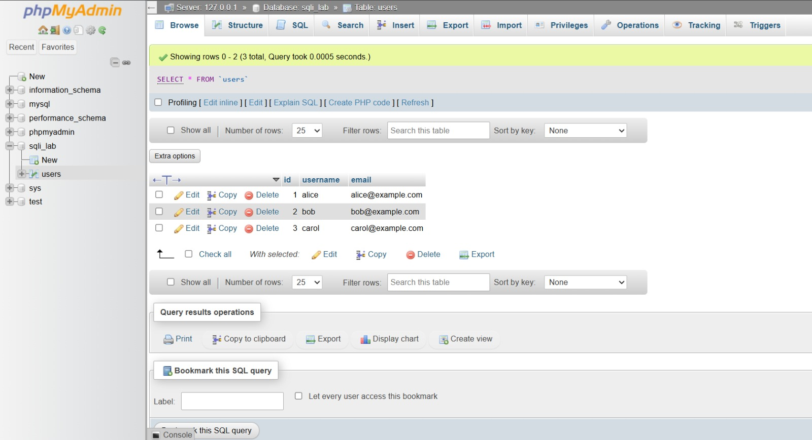
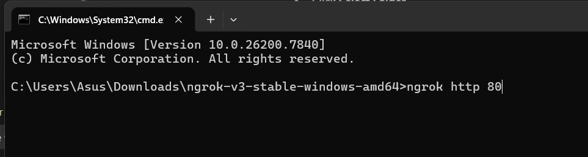
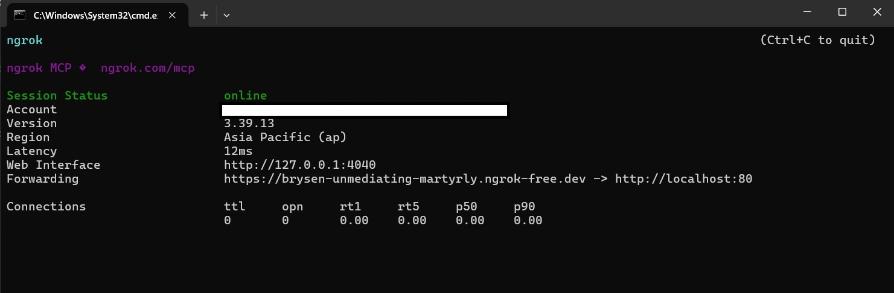

# SQLi SCANNER
### A PHP-Based SQL Injection Detection Tool


---

## 1. Project Overview

**SQLi SCANNER** is a PHP-based web application security testing tool developed to identify potential SQL Injection (SQLi) vulnerabilities in web applications.

The tool analyses URL query parameters and performs several basic detection techniques to identify possible SQL Injection indicators. It provides a dashboard where users can initiate scans, review findings, examine risk scores, view scan history, and export reports.

The project is designed for educational purposes and authorised security testing in controlled laboratory environments.

### Project Information

| Item | Description |
|---|---|
| Project Name | SQLi SCANNER |
| Project Type | Web-Based Security Testing Tool |
| Attack Category | Web Application Attack |
| Main Language | PHP |
| Database | MySQL |
| Local Server | XAMPP |
| Database Management | phpMyAdmin |
| Public Demo Tunnel | ngrok |
| Testing Environment | Local Vulnerable Web Application / DVWA |


---

## 2. Project Objectives

The main objectives of SQLi SCANNER are:

- To develop a web-based tool that detects potential SQL Injection vulnerabilities.
- To implement Error-Based, Boolean-Based, and Time-Based SQL Injection detection techniques.
- To analyse URL query parameters and identify suspicious application responses.
- To display scan results through a user-friendly dashboard.
- To provide risk scores and evidence for detected findings.
- To generate downloadable CSV reports.
- To promote responsible and authorised security testing.

---

## 3. Features

### 3.1 SQL Injection Detection

SQLi SCANNER implements three basic SQL Injection detection techniques:

| Detection Technique | Description |
|---|---|
| Error-Based Detection | Checks whether modified input causes database-related error messages to appear in the response. |
| Boolean-Based Detection | Compares responses from true and false SQL conditions to identify differences in application behaviour. |
| Time-Based Detection | Checks whether a specially crafted test input causes a noticeable response delay. |

### 3.2 Dashboard

The dashboard provides an overview of scan activities, including:

- Total scans completed.
- Number of scans with findings.
- Total findings detected.
- Number of HTTP requests sent.
- Latest scan results.
- Risk score visualisation.
- Detection technique statistics.

### 3.3 Scan History

The application provides a scan history section where users can:

- Review previous scans in the current PHP session.
- View scan details.
- Open individual scan reports.
- Clear the scan history.

**Note:** Scan history is maintained using PHP sessions and is limited to the latest 15 scans. It is not permanent database storage.

### 3.4 Scan Reports

Each scan report provides information such as:

- Target URL.
- Scan date and time.
- Number of tested parameters.
- Number of affected parameters.
- Detection techniques.
- Severity levels.
- Risk score.
- Scan duration.
- Number of HTTP requests.

### 3.5 CSV Export

Users can export scan results into CSV format for documentation, further analysis, and reporting.

### 3.6 Local Laboratory Target Restriction

The scanner includes a basic target validation function intended to restrict scanning to localhost and private-network targets.

This restriction is a safety measure for laboratory testing. It should not be treated as a complete security boundary or a replacement for an explicit target allowlist.

---

## 4. System Requirements

Before running SQLi SCANNER, make sure the following software is installed:

| Software | Requirement | Purpose |
|---|---|---|
| XAMPP | Required | Runs Apache and MySQL |
| PHP | PHP 8.0 or later | Executes the application |
| MySQL | Included with XAMPP | Stores vulnerable test application data |
| phpMyAdmin | Included with XAMPP | Manages the database |
| Web Browser | Required | Accesses the application |
| ngrok | Optional | Provides a temporary public demo URL |

### PHP Extensions

The following PHP extensions should be enabled:

- mysqli
- curl

The application uses PHP cURL to send HTTP requests to testing targets.

---

## 5. Repository Structure

The project files should be organised as follows:

```text
SQLi-SCANNER/
│
├── index.php
├── auth.php
├── login.php
├── logout.php
├── history.php
├── report.php
├── vuln.php
├── setup.sql
│
├── .gitignore
├── LICENSE
├── README.md
│
└── assets/
    └── screenshots/
        ├── xampp-control-panel.jpeg
        ├── phpmyadmin-database.jpeg
        ├── ngrok-command.jpeg
        └── ngrok-public-url.jpeg
```

**Important:**

- `index.php` contains the main scanner dashboard and detection logic.
- `auth.php` handles authentication-related functions.
- `login.php` handles administrator login and initial account setup.
- `logout.php` handles logout.
- `history.php` displays scan history.
- `report.php` displays individual scan reports.
- `vuln.php` is an intentionally vulnerable PHP page used for testing.
- `setup.sql` creates the database and sample records.
- `auth_data.json` is generated when the initial administrator account is created. It should not be committed to GitHub.

The repository structure above is the intended organisation. If your actual folder or screenshot filenames differ, update the names accordingly.

---

## 6. Installation and Setup

Follow these steps to install and run SQLi SCANNER locally.

### Step 1: Install XAMPP

Download and install XAMPP if it is not already installed.

Official website:

https://www.apachefriends.org/

### Step 2: Start Apache and MySQL

1. Open XAMPP Control Panel.
2. Click **Start** for Apache.
3. Click **Start** for MySQL.
4. Make sure both services are running.

Screenshot:



### Step 3: Copy the Project into htdocs

1. Locate your XAMPP installation folder.
2. Open the `htdocs` directory.
3. Copy the SQLi SCANNER project folder into `htdocs`.

Example:

```text
C:\xampp\htdocs\SQLi-SCANNER\
```

### Step 4: Create the Database

1. Open your web browser.
2. Visit:

```text
http://localhost/phpmyadmin
```

3. Select the **Import** tab.
4. Choose the `setup.sql` file from the project folder.
5. Click **Import** or **Go**.
6. Confirm that the database and sample table have been created.

The SQL setup file creates the `sqli_lab` database and its sample `users` table.

Screenshot:



### Step 5: Check Database Configuration

The vulnerable testing page uses the following default MySQL connection:

```php
mysqli_connect("localhost", "root", "", "sqli_lab");
```

If your MySQL username, password, or database configuration is different, update the connection settings in `vuln.php`.

For a local XAMPP installation, the default root account may have an empty password. Configure it according to your own environment.

### Step 6: Enable PHP cURL

The scanner requires the PHP cURL extension.

1. Open the XAMPP installation directory.
2. Locate the `php.ini` configuration file.
3. Search for:

```ini
;extension=curl
```

4. Remove the semicolon if the extension is disabled:

```ini
extension=curl
```

5. Save the file.
6. Restart Apache from XAMPP Control Panel.

### Step 7: Open SQLi SCANNER

Open your browser and access:

```text
http://localhost/SQLi-SCANNER/
```

If the project folder has a different name, replace `SQLi-SCANNER` with the actual folder name.

### Step 8: Initial Administrator Setup

On the first login, follow the initial account setup process provided by `login.php`.

Create the administrator account and use the account credentials to access the dashboard.

The application stores the administrator account information in `auth_data.json`, with the password protected using PHP password hashing.

Keep this file private and do not upload it to a public repository.

---

## 7. How to Use SQLi SCANNER

### Step 1: Login

Open the application and log in using the administrator account.

### Step 2: Enter a Target URL

Navigate to the dashboard and locate the **New Scan** section.

Enter a target URL containing query parameters.

Example:

```text
http://localhost/SQLi-SCANNER/vuln.php?id=1
```

The scanner currently analyses GET query parameters.

### Step 3: Provide an Optional Cookie

For authenticated laboratory applications, users can provide an optional session cookie.

Example format:

```text
PHPSESSID=your_session_id; security=low
```

Only use session cookies belonging to your own authorised test environment.

Do not share real session cookies or commit them to GitHub.

### Step 4: Start the Scan

Click the **Start Scan** button.

The scanner sends HTTP requests using its detection techniques and analyses the returned responses.

### Step 5: Review the Results

After the scan finishes, review the dashboard and scan report.

The results may include:

- Detection technique.
- Affected parameter.
- Evidence.
- Severity.
- Risk score.
- Recommended remediation.

### Step 6: Export the Report

Use the CSV export function to download the scan results.

The exported file can be opened using spreadsheet applications for documentation and further analysis.

---

## 8. SQL Injection Detection Techniques

SQLi SCANNER uses three detection techniques.

### 8.1 Error-Based SQL Injection

Error-based detection checks whether unexpected input causes SQL-related error messages to appear in the HTTP response.

The scanner tests input variations such as quotation marks and checks for recognised database error signatures.

Examples of checked error indicators include:

- MySQL syntax errors.
- mysqli-related errors.
- PostgreSQL query errors.
- SQLite-related errors.
- SQLSTATE.
- ODBC errors.

A detected error indicator may suggest that user input is being processed unsafely by a database query.

### 8.2 Boolean-Based SQL Injection

Boolean-based detection compares the responses generated by true and false SQL conditions.

The scanner checks whether:

- A true condition produces a response similar in length to the original page.
- A false condition produces a different response length.

A difference in response behaviour may indicate that the input affects the underlying SQL query.

### 8.3 Time-Based SQL Injection

Time-based detection checks whether a test input causes a noticeable delay in the server response.

The scanner uses a test payload containing:

```sql
' AND SLEEP(3)-- -
```

It then compares the response time with the baseline response time.

A noticeable delay may indicate possible time-based SQL Injection behaviour.

**Important:** These techniques are heuristic checks. A detection result is an indicator that requires manual verification, not definitive proof of a vulnerability.

---

## 9. Risk Scoring and Severity

The scanner assigns severity levels to findings based on the detection technique.

| Detection Technique | Severity | Score Weight |
|---|---|---:|
| Boolean-Based | Critical | 45 |
| Error-Based | High | 30 |
| Time-Based | High | 30 |

The total risk score is calculated using the weights assigned to detected findings.

The maximum displayed score is capped at 100.

### Risk Categories

| Risk Score | Category |
|---|---|
| 0–29 | Low Risk |
| 30–69 | Elevated Risk |
| 70–100 | Critical Risk |

The risk score is an internal prioritisation indicator, not a formal CVSS score or a measure of confirmed exploitability.

---

## 10. Testing Environment

SQLi SCANNER is intended to be tested using controlled laboratory applications.

### 10.1 Custom Vulnerable PHP Application

The project includes `vuln.php`, an intentionally vulnerable PHP page.

It contains an unsafe SQL query that directly combines user input with SQL statements.

Example:

```php
$id = $_GET['id'] ?? '1';

$sql = "SELECT username, email FROM users WHERE id = '$id'";
```

This page is intentionally insecure so that the scanner can be tested against a known vulnerable application.

Example test URL:

```text
http://localhost/SQLi-SCANNER/vuln.php?id=1
```

**Warning:** Never deploy `vuln.php` on a public production server.

### 10.2 DVWA (Optional)

Damn Vulnerable Web Application (DVWA) is another intentionally vulnerable application that can be used as an additional SQL Injection testing environment.

Official repository:

https://github.com/digininja/DVWA

DVWA can be configured locally as a separate testing application.

When testing authenticated DVWA pages, the appropriate session cookie may be required.

The scanner and DVWA are separate applications. Their database configurations are not interchangeable.

Only test DVWA installations that you own or are authorised to assess.

---

## 11. Ngrok Public Demonstration

ngrok is used to provide a temporary public URL for demonstrating the local web application.

It allows another person, such as a lecturer or group member, to access the demonstration website through a public forwarding URL.

### Step 1: Start XAMPP

Make sure Apache is running in XAMPP Control Panel.

### Step 2: Open the Terminal

Open Command Prompt or PowerShell.

### Step 3: Start ngrok

If ngrok is installed and configured, run:

```bash
ngrok http 80
```

### Step 4: Copy the Forwarding URL

ngrok will generate a public HTTPS forwarding URL.

Example:

```text
https://example.ngrok-free.app
```

Use the generated URL to access the demonstration website.

Screenshots:





### Security Warning

A public ngrok URL exposes the local web application to external visitors while the tunnel is active.

- Use ngrok only for a controlled demonstration.
- Do not expose phpMyAdmin.
- Do not expose database administration interfaces.
- Do not expose vulnerable test pages such as `vuln.php` or DVWA.
- Never share administrator credentials or session cookies.
- Stop the ngrok tunnel immediately after the demonstration.

The scanner's target validation is designed for localhost and private-network testing. A public ngrok URL should not be treated as an authorised scanning target.

---

## 12. Attack Lifecycle Mapping

SQLi SCANNER supports the vulnerability assessment and analysis stages of the ethical hacking lifecycle.

| Lifecycle Stage | Application Activity |
|---|---|
| Reconnaissance | The tester identifies the authorised web application and its URL parameters. |
| Scanning | The scanner sends test requests to identify possible SQL Injection indicators. |
| Vulnerability Analysis | The application analyses response content, response differences, and response timing. |
| Reporting | The scanner presents findings, severity levels, risk scores, and evidence. |
| Remediation | The report provides recommendations to help developers fix potential SQL Injection weaknesses. |
| Verification | The tester can perform another authorised scan after remediation to check whether the indicators remain. |

**Scope:** SQLi SCANNER is a detection and reporting tool. It does not perform full exploitation, database extraction, privilege escalation, or post-exploitation activities.

---

## 13. Ethical Considerations

SQLi SCANNER is developed for educational and authorised security testing.

Users must ensure that every scan is conducted within a clearly defined scope.

The project follows these ethical principles:

- Obtain permission before testing any application.
- Use localhost or private laboratory environments by default.
- Avoid scanning systems owned by other individuals or organisations without written authorisation.
- Do not attempt to extract, modify, or delete sensitive information.
- Do not use the tool to disrupt services.
- Protect administrator credentials and session cookies.
- Stop testing if unexpected behaviour or service disruption occurs.
- Report discovered vulnerabilities responsibly.

---

## 14. Rules of Engagement (RoE)

The following Rules of Engagement define how SQLi SCANNER should be used.

### 14.1 Authorised Scope

Permitted targets:

- Localhost applications.
- Private-network laboratory systems.
- Intentionally vulnerable applications.
- Systems covered by explicit written authorisation.

Targets outside the approved scope must not be tested.

### 14.2 Testing Time Window

Testing should only take place during the approved laboratory or assessment period.

For external authorised assessments, the testing time window must be agreed upon with the system owner.

### 14.3 Permitted Techniques

The scanner is designed to perform:

- Error-Based SQL Injection checks.
- Boolean-Based SQL Injection checks.
- Time-Based SQL Injection checks.

### 14.4 Prohibited Activities

Users must not:

- Scan public websites without permission.
- Extract real user information or database contents.
- Modify or delete production data.
- Perform denial-of-service testing.
- Attempt privilege escalation.
- Use the tool for unauthorised access.

### 14.5 Emergency Stop Procedure

If unexpected behaviour, excessive delays, or service disruption occurs:

1. Stop initiating additional scans.
2. If the request is still running under XAMPP, stop the Apache service through XAMPP Control Panel to terminate the local web request.
3. Check the application and server logs.
4. Inform the system owner or laboratory supervisor if the test environment is affected.

**Current implementation note:** The application does not currently provide a dedicated in-app kill switch to cancel an active scan. Stopping Apache is a manual emergency measure and will also make the local application temporarily unavailable.

---

## 15. Responsible Disclosure

If a potential SQL Injection vulnerability is discovered during an authorised assessment, the tester should follow responsible disclosure practices.

The recommended process is:

1. Record the affected URL and parameter.
2. Document the detection technique and observed evidence.
3. Avoid accessing or collecting sensitive information.
4. Notify the system owner or designated security contact.
5. Provide a clear explanation of the potential impact.
6. Recommend appropriate remediation.
7. Allow the organisation to investigate and resolve the issue.
8. Verify the remediation only with permission.

Do not publicly disclose vulnerability details before the responsible disclosure process has been completed.

---

## 16. Recommended Remediation

Developers should apply secure coding practices to prevent SQL Injection vulnerabilities.

Recommended security measures include:

### Use Prepared Statements

Use PDO or MySQLi prepared statements instead of directly concatenating user input into SQL queries.

Example using MySQLi:

```php
$stmt = $db->prepare(
    "SELECT username, email FROM users WHERE id = ?"
);

$stmt->bind_param("i", $id);
$stmt->execute();
```

### Additional Recommendations

- Validate and sanitise user input appropriately.
- Use parameterised database queries.
- Hide detailed SQL error messages from public users.
- Use database accounts with least-privilege permissions.
- Keep PHP and database software updated.
- Log errors securely for administrator review.
- Apply secure session management.

---

## 17. Data Handling and Privacy

SQLi SCANNER processes HTTP responses and scan information during testing.

The application maintains scan history using PHP sessions.

Users should take the following precautions:

- Do not scan URLs containing sensitive personal information.
- Do not use real production session cookies.
- Do not upload authentication data to public repositories.
- Keep generated authentication files private.
- Clear scan history when it is no longer required.
- Avoid sharing CSV reports containing sensitive target information.

The scanner is intended for local educational testing and does not provide a permanent secure evidence-management system.

---

## 18. Limitations

SQLi SCANNER is an educational project and has several technical limitations.

1. **GET Parameters Only:** The current implementation analyses URL query parameters. It does not perform comprehensive testing of POST parameters, JSON bodies, or other request formats.

2. **Heuristic Detection:** Detection is based on response content, response length, and timing. These indicators can produce false positives or false negatives.

3. **Limited Database Signatures:** The scanner checks a basic set of database error signatures and does not support every database engine or configuration.

4. **Authentication Handling:** Authenticated testing depends on the user providing an appropriate session cookie.

5. **Response Handling:** The scanner does not follow HTTP redirects and may not properly assess applications that require complex authentication or navigation.

6. **Target Validation:** The current target validation is a basic safeguard and is not a complete network security boundary. DNS resolution and address validation require further hardening.

7. **No Dedicated Kill Switch:** The current application does not include an in-app function to cancel an active scan.

8. **Session-Based History:** Scan history is stored in PHP sessions and is limited to the latest 15 scans. It is not permanently stored in MySQL.

9. **No Full Exploitation:** The scanner identifies possible SQL Injection indicators but does not extract database contents or perform full exploitation.

10. **Laboratory Use:** The tool has been designed for educational testing and should not be considered a replacement for professional penetration-testing solutions.

---

## 19. Future Improvements

Potential future improvements include:

- Add POST parameter scanning.
- Improve SQL Injection detection accuracy.
- Add support for more database technologies.
- Implement configurable request timeouts.
- Add an in-app scan cancellation mechanism.
- Improve DNS resolution and target allowlisting.
- Introduce persistent scan history storage.
- Add authentication and session management improvements.
- Generate PDF reports.
- Add more detailed vulnerability remediation guidance.
- Improve scan validation and testing coverage.

---

## 20. Installation and Security Checklist

Before using the application, confirm the following:

- [ ] XAMPP is installed.
- [ ] Apache is running.
- [ ] MySQL is running.
- [ ] PHP cURL and MySQLi extensions are enabled.
- [ ] The `sqli_lab` database has been imported.
- [ ] The project is located inside the XAMPP `htdocs` directory.
- [ ] The administrator account has been configured.
- [ ] The application opens successfully in the browser.
- [ ] Testing is restricted to authorised laboratory targets.
- [ ] No credentials, session cookies, or generated authentication files are committed to GitHub.

---

## 21. Release

### Release

The project release should use the following version information:

```text
Version: v1.0.0
Release Title: SQLi SCANNER v1.0.0
```

Create the GitHub Release after confirming that the project files, documentation, and testing evidence are ready.

---

## 22. License

This project is distributed under the MIT License.

See the `LICENSE` file for more information.

---

## 23. Disclaimer

SQLi SCANNER is developed strictly for educational purposes, cybersecurity learning, and authorised security assessments.

The developer does not authorise or encourage unauthorised access, testing, exploitation, or damage to any computer system.

Users are responsible for ensuring that they have appropriate permission before conducting security tests.

In Malaysia, users must comply with applicable laws, including the **Computer Crimes Act 1997 (Act 563)**.

The tool is provided "as is", without any guarantee of accuracy, completeness, or fitness for a particular purpose.

**Use SQLi SCANNER responsibly. Test only systems you own or have explicit permission to assess.**

---

### Developed for IKB31603 – Ethical Hacking
**Project: SQLi SCANNER**
